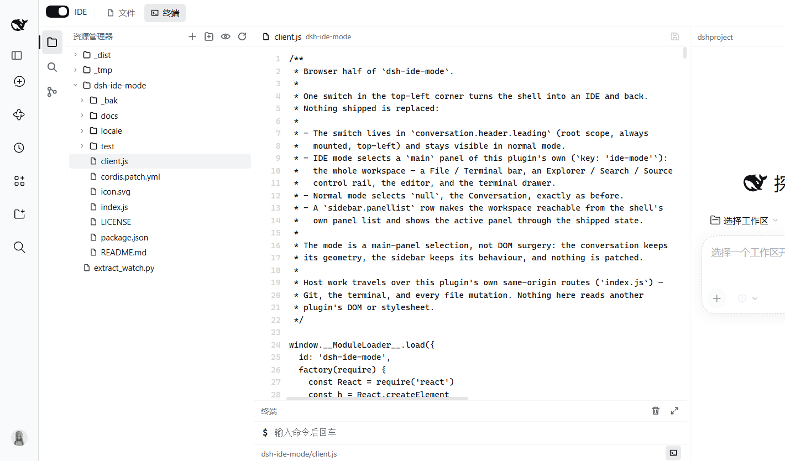
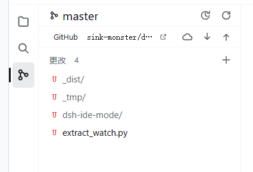

# DSH IDE Mode

**An IDE around the conversation, not instead of it.**

`dsh-ide-mode` is a DeepSeek Harness plugin that adds one switch to the shell.
Flip it and the main column becomes a workspace — Explorer, Search, Source
control, an editor, and a terminal drawer — while the conversation keeps
streaming in its own column to the right. Flip it back and nothing is left over.



[](LICENSE)
[](#development)
[](package.json)
[](https://github.com/sink-monster/dsh-ide-mode)

## Features

**Mode switch** — a toggle at the top-left of the conversation header, plus a
`sidebar.panellist` row so the workspace is reachable from the shell's own panel
list. The mode is a `main` panel selection, so the sidebar, the conversation, and
every other plugin keep their geometry and behaviour; nothing is patched.

**Explorer** — the Session's working directory, one level at a time, read on
demand and cached until refresh. Create files and folders anywhere you can type
a path. Hidden entries are opt-in.

**Search** — two modes over the same box. **Name** matches file names
case-insensitively. **Content** greps every file and lists one row per hit with
its line number and trimmed line; clicking a row opens the file. Files above
512 KB and files containing a NUL byte are skipped, the walk stops after 8000
files, and generated directories (`node_modules`, `dist`, `.git`, `target`,
virtualenvs) are never entered.

**Source control** — the system `git`, run in the Session's directory: branch,
upstream, ahead/behind, staged and changed groups, stage/unstage per row and per
group, a commit box, inline diff per path (untracked files included), discard,
branch switching, and commit history.

**GitHub, without leaving the panel** — the remote row shows the `GitHub` badge
and the `owner/repo` the workspace pushes to, with fetch, pull (fast-forward
only), and push. Click it to open the repository in your browser; with a GitHub
remote, every commit in the history links to its own page.



**Editor** — monospace, line-number gutter, two-space Tab, dirty marker. Save
writes to disk; Revert restores the loaded text. Switching away from an unsaved
buffer asks first — save and open, discarding is flagged as destructive, cancel
stays put. Binary and oversized files are reported, never loaded as text.

**Terminal drawer** — one command per round trip, run in the Session's directory,
output and exit code attached. Click anywhere in the drawer to focus the prompt,
`↑`/`↓` walk history, `Esc` clears the line. A command times out after two
minutes so a runaway cannot hold the page.

**Layout memory** — the rail panel, the drawer state, and the conversation
column's visibility and width survive a reload (`localStorage` key
`dsh-ide-mode:layout`). Every field is validated on read; a corrupt or partial
value falls back field by field instead of failing the boot.

**Bilingual** — every string ships in Simplified Chinese and English through the
shell's own i18n namespace.

## Tech stack

No build step, no bundler, no runtime dependencies. Both halves ship as source.

| Layer | What it uses |
| --- | --- |
| Language | JavaScript, native ESM — no TypeScript, no transpile |
| Host | Node.js (the DSH runtime), Cordis plugin API: `export const name/inject/apply`, `ctx.connection`, `ctx.subprocess`, `ctx.webServer` |
| Host I/O | `node:fs/promises`, `node:path`, `node:child_process` — a `git` binary is spawned with an **argv array**, never through a shell |
| Client | React 18 through DSH's module loader (`window.__ModuleLoader__.load`), hooks, `React.createElement` — no JSX, no virtual-DOM framework of its own |
| Shell integration | `ctx.slots` (`main`, `conversation.header.leading`, `sidebar.panellist`), `ctx.layout` main-panel selection, `ctx.shortcuts`, `ctx.i18n` namespace `ide-mode` |
| Styling | One CSS template string of hand-written rules, scoped under `.dide-*`, using the shell's design tokens (`--dsw-alias-*`) so both themes and density settings follow |
| Packaging | A DSH **bundle**: `cordis.patch.yml` inserts the Host row, `package.json#dsh.client` serves the browser half; distributed as a package (`github:` / tarball / `link:`) |
| Tooling under test | Plain `node:` scripts with assertion helpers — 62 activation checks and 145 Host/route checks |

Deliberate non-choices: no syntax highlighting, no language server, no PTY in
the drawer, no multi-root workspace. Each would double the surface without
changing what the panel is for.

## Install

Three ways, pick one. All of them install **from the repository**, not from a
path on someone's disk.

**1. From GitHub (recommended)**

```bash
# put the package into the profile
dsh plugin --profile desktop add github:sink-monster/dsh-ide-mode

# register it as a bundle of that profile
# (profile package.json → dsh.profile.bundles, append "dsh-ide-mode")
```

**2. From a release tarball**

```bash
dsh plugin --profile desktop add https://github.com/sink-monster/dsh-ide-mode/releases/download/v1.0.0/dsh-ide-mode-1.0.0.tgz
```

**3. For development, from a clone**

```bash
git clone git@github.com:sink-monster/dsh-ide-mode.git
dsh plugin --profile desktop add ./dsh-ide-mode
```

`dsh plugin` forwards everything to `pnpm` inside the profile directory, so any
spec pnpm understands works. The install only puts the package in place — the
bundle still has to be on the profile's `dsh.profile.bundles` list:

```json
{
  "dsh": {
    "profile": {
      "bundles": ["@deepseek-ai/dsh-base", "@deepseek-ai/dsh-web-app", "dsh-ide-mode"]
    }
  }
}
```

Then reload the window: **Plugins → IDE mode → enable**, or the toggle in the
top-left corner once the browser half has loaded. In the packaged desktop app
there is no `Ctrl+R`; use `Ctrl+Shift+I` → Console → `location.reload()`, or quit
and reopen the app.

### Requirements

| | |
| --- | --- |
| DeepSeek Harness | a build that ships `dsh-web-app` (the plugin registers into `main`, `conversation.header.leading`, and `sidebar.panellist`) |
| Node.js | whatever the DSH runtime ships — no extra modules are loaded |
| Git | any `git` on `PATH`, or one of the usual install locations: `D:\Soft Ware\Git\cmd\git.exe`, `Program Files\Git\…`, a portable `PortableGit`, or the ops shell bundle. Only a real file is accepted, so a directory that happens to satisfy an executable probe is never spawned |
| Browser | a current Chromium/WebKit/Firefox — the client half is plain DOM + CSS |

## Usage

| Action | How |
| --- | --- |
| Enter / leave IDE mode | the switch top-left, or the **IDE mode** row in the panel list |
| Bind a keyboard shortcut for it | Settings → Shortcuts → command `ide-mode.toggle` (no default binding: `Ctrl/Cmd+Tab` is reserved and macOS rejects the cross-platform chords) |
| Save the open file | `Ctrl+S` / `⌘S`, or File → Save |
| Commit | `Ctrl+Enter` / `⌘Enter` in the commit box |
| Run a command | type in the drawer's prompt row, `Enter`; `↑`/`↓` for history, `Esc` to clear |
| Open the repository | click the remote row |
| Resize the conversation column | drag the separator left of it |

## HTTP routes

The Host half is one set of same-origin routes, every one behind the
composition's `connection` trust fence (Host/Origin check plus browser
authentication) and with its own JSON body validated at the wire.

| Route | Purpose |
| --- | --- |
| `POST /ide-mode/git/status` | branch, upstream, divergence, porcelain-v1 rows |
| `POST /ide-mode/git/index` | stage or unstage explicit paths |
| `POST /ide-mode/git/commit` | commit the index with one message |
| `POST /ide-mode/git/diff` | working-tree or staged diff for one path |
| `POST /ide-mode/git/discard` | discard worktree changes, or unstage everything |
| `POST /ide-mode/git/branch` | list local branches, or switch to one |
| `POST /ide-mode/git/log` | the newest commits |
| `POST /ide-mode/git/init` | create a repository in the workspace root |
| `POST /ide-mode/git/remote` | the remote the workspace pushes to, as coordinates |
| `POST /ide-mode/git/sync` | fetch, pull `--ff-only`, or push one time |
| `POST /ide-mode/exec` | run one shell command in a workspace directory |
| `POST /ide-mode/fs/list` | list one directory's direct children |
| `POST /ide-mode/fs/search` | find files by name, or grep their contents, under the workspace root |
| `POST /ide-mode/fs/read` | read one file as UTF-8 text (binary refused) |
| `POST /ide-mode/fs/write` | create or overwrite one file |
| `POST /ide-mode/fs/mkdir` | create one directory, parents included |
| `POST /ide-mode/fs/delete` | remove one file or directory tree |

Containment is one rule for every filesystem route: the caller names the
workspace `root` and a target, and the target must already resolve inside it.
Git receives `--` before pathspecs and refuses a path that starts with `-`, so a
file name can never be re-read as an option.

## Architecture

```
dsh-ide-mode/
├─ index.js            Host half: 17 routes, git resolution, containment
├─ client.js           Browser half: slots, panels, IDE shell, CSS
├─ cordis.patch.yml    Bundle insert: one Host row (`ide-mode`)
├─ locale/{zh,en}.json Shell strings, namespace `ide-mode`
├─ docs/DETAIL.md      Behaviour, screen by screen
└─ test/               activation.test.mjs, host.test.mjs
```

The plugin never reads another plugin's DOM or stylesheet. It registers a `main`
panel, asks `ctx.layout` to select it, and mounts its own slots; the conversation
is rendered through the shell's `conversation.content` factory slot so streaming,
tools, and the composer behave exactly as they do in normal mode.

## Development

```bash
node test/activation.test.mjs   # bundles client.js through a DOM stub → 62 checks
node test/host.test.mjs         # mounts the Host routes against fixtures → 145 checks
```

Both scripts are dependency-free and exit non-zero on the first failed check, so
they work as a pre-commit gate and in CI. Notes:

- The activation suite loads `client.js` with `new Function` against stub
  `window`/`document`/`localStorage` objects — a syntax error anywhere surfaces
  immediately, which is why the file is checked before anything else.
- The Host suite drives real route handlers with a fake `subprocess` provider
  and asserts on the exact argv each Git call is given.
- `docs/DETAIL.md` is the reference for behaviour; keep it and the locale files
  in step with the code when a string or a route changes.

## Limits

- Text editing only — no syntax highlighting, no language server.
- One buffer at a time: switching files asks before dropping an unsaved edit
  instead of keeping both open.
- Source control covers the working tree plus one remote round trip (fetch, pull
  `--ff-only`, push). Rebase, merge resolvers, and interactive credential prompts
  are out of scope; `discard` only ever touches the worktree, never `--hard`.
- The terminal drawer keeps no shell state between commands (`cd` does not
  persist) and is not a PTY. Use the shipped right-Sidebar terminal for an
  interactive shell.
- Search reads contents in **Content** mode only, one line at a time, and never
  follows a symlink out of the workspace.

## License

[MIT](LICENSE) © 2026 sink-monster