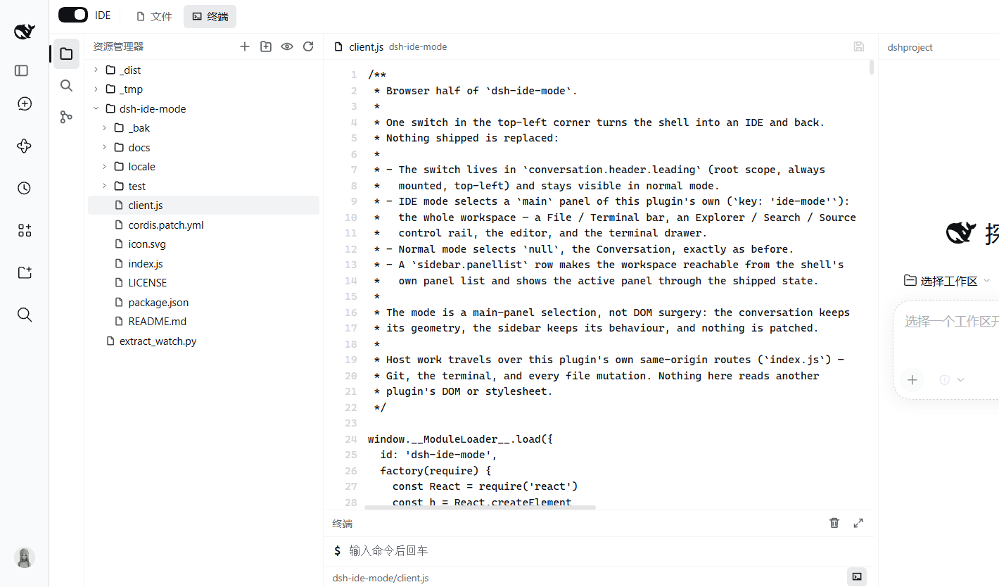
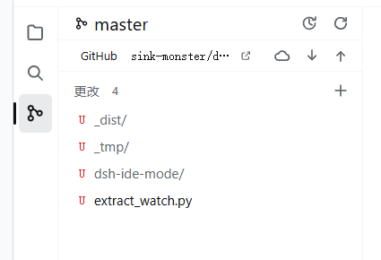

# DSH IDE Mode

DeepSeek Harness 的 IDE 模式插件。它在对话页左上角加一个开关，打开后主区域变成工作区：
资源管理器、查找、源代码管理、编辑器和可展开的终端，对话留在右侧独立一列继续输出。



[](LICENSE)
[](#测试)
[](package.json)

[English](README.md) · 简体中文

## 功能

**模式开关。** 开关挂在 `conversation.header.leading`，同时也会出现在侧栏的面板列表里。
打开模式时选中本插件注册的 `main` 面板，关闭时切回对话。侧栏、对话列和其他插件的布局互不影响。

**资源管理器。** 按层读取会话工作目录，只读当前层，缓存到手动刷新为止。可以在顶部新建文件或
目录，隐藏文件默认不显示。

**查找。** 同一个输入框支持两种模式。按文件名查找时忽略大小写；按内容查找时逐个文件搜索，
命中行以「文件:行号」加该行文本列出，点击直接打开文件。超过 512 KB 的文件、含 NUL 字节的
二进制文件会跳过，遍历上限 8000 个文件，`node_modules`、`dist`、`.git`、`target`、虚拟环境
等生成目录不进入。

**源代码管理。** 在会话目录执行系统 `git`：分支、上游、领先/落后、已暂存与未暂存分组、逐
行与整组暂存、提交框、单文件行内 diff、丢弃改动、切换分支、最近提交历史。

**GitHub。** 远端行显示服务标识（github.com 显示 `GitHub`）和工作区推送的 `owner/repo`，
右侧是获取、拉取（仅快进）和推送。点击该行在浏览器打开仓库；远端是 GitHub 时，历史里的每个
提交都能点开对应页面。



**编辑器。** 等宽字体、行号槽、两空格 Tab、未保存标记。保存写盘，还原回到加载时的文本。
缓冲区有未保存修改时切换文件会先询问，可选择保存后打开、放弃修改或取消。二进制和超大文件
给出提示而不是加载。

**终端抽屉。** 一次请求执行一条命令，工作目录为会话目录，返回输出和退出码。点击抽屉任意
位置都会聚焦输入行；`↑` `↓` 翻历史，`Esc` 清空当前行。命令两分钟超时。

**布局记忆。** 左侧面板、终端抽屉状态、对话列是否显示及宽度存在 `localStorage` 的
`dsh-ide-mode:layout` 下。读取时逐字段校验，某个字段损坏只回退该字段。

**多语言。** 界面文案全部走宿主的 i18n 命名空间 `ide-mode`，内置简体中文与英文。

## 技术栈

没有构建步骤，也没有运行时依赖，前后两半都是直接运行的源码。

| 层 | 实现 |
| --- | --- |
| 语言 | JavaScript，原生 ESM |
| Host | Node.js + Cordis 插件 API（`name` / `inject` / `apply`）、`ctx.connection`、`ctx.subprocess`、`ctx.webServer` |
| Host I/O | `node:fs/promises`、`node:path`、`node:child_process`；`git` 以参数数组 spawn，不经过 shell |
| Client | 由 DSH 模块加载器加载的 React 18，hooks，`React.createElement`（无 JSX、无打包器） |
| 宿主 API | `ctx.slots`（`main`、`conversation.header.leading`、`sidebar.panellist`）、`ctx.layout`、`ctx.shortcuts`、`ctx.i18n` |
| 样式 | 单条 CSS 字符串，全部限定在 `.dide-*` 类下，颜色尺寸取自宿主令牌（`--dsw-alias-*`），跟随主题与密度设置 |
| 打包 | DSH bundle：`cordis.patch.yml` 插入 Host 行，`package.json#dsh.client` 提供浏览器半 |
| 测试 | 两个 `node:` 脚本加断言辅助，分别为 62 与 145 项检查 |

## 安装

**从 GitHub 安装**

```bash
dsh plugin --profile desktop add github:sink-monster/dsh-ide-mode
```

然后把包名写进 profile 的 `package.json` 里的 bundle 列表：

```json
{
  "dsh": {
    "profile": {
      "bundles": ["@deepseek-ai/dsh-base", "@deepseek-ai/dsh-web-app", "dsh-ide-mode"]
    }
  }
}
```

**用本地打好的包安装**

```bash
git clone https://github.com/sink-monster/dsh-ide-mode.git
cd dsh-ide-mode && pnpm pack          # 得到 dsh-ide-mode-1.1.0.tgz
dsh plugin --profile desktop add ./dsh-ide-mode-1.1.0.tgz
```

**开发时直接用目录**

```bash
git clone https://github.com/sink-monster/dsh-ide-mode.git
dsh plugin --profile desktop add ./dsh-ide-mode
```

`dsh plugin` 会把参数转发给 profile 目录里的 `pnpm`，所以 pnpm 支持的写法都能用。装完刷新
窗口；打包版桌面应用里按 `Ctrl+Shift+I` 打开控制台执行 `location.reload()`，或直接重启应用。

### 环境要求

- 带 `dsh-web-app` 的 DeepSeek Harness。插件注册到 `main`、
  `conversation.header.leading` 和 `sidebar.panellist` 三个位置。
- `PATH` 里有 Git，或位于下列之一：`D:\Soft Ware\Git\cmd\git.exe`、`Program Files\Git\…`、
  便携版 `PortableGit`、ops shell 自带的 git。只接受真实文件，目录会被跳过。
- 较新的 Chromium、WebKit 或 Firefox，供浏览器半使用。

## 使用

| 操作 | 方式 |
| --- | --- |
| 进入/退出 IDE 模式 | 左上角开关，或面板列表里的 IDE 模式一项 |
| 给开关绑定快捷键 | 设置 → 快捷键 → `ide-mode.toggle`（默认不占用按键） |
| 保存当前文件 | `Ctrl+S` / `⌘S`，或 文件 → 保存 |
| 提交 | 在提交框内 `Ctrl+Enter` / `⌘Enter` |
| 执行命令 | 在抽屉输入行输入后回车；`↑` `↓` 翻历史，`Esc` 清空 |
| 打开仓库 | 点击远端行 |
| 调整对话列宽度 | 拖动它旁边的分隔条 |

## HTTP 路由

所有路由同源，先经过组合层的 `connection` 栅栏（Host 与 Origin 校验加浏览器鉴权），然后才
读取请求体。

| 路由 | 用途 |
| --- | --- |
| `POST /ide-mode/git/status` | 分支、上游、领先落后、porcelain v1 行 |
| `POST /ide-mode/git/index` | 暂存或取消暂存路径 |
| `POST /ide-mode/git/commit` | 用给定信息提交暂存区 |
| `POST /ide-mode/git/diff` | 单文件工作区或暂存区 diff |
| `POST /ide-mode/git/discard` | 丢弃工作区改动，或全部取消暂存 |
| `POST /ide-mode/git/branch` | 列出本地分支，或切换 |
| `POST /ide-mode/git/log` | 最近提交 |
| `POST /ide-mode/git/init` | 在工作区根目录建仓库 |
| `POST /ide-mode/git/remote` | 推送远端的主机、owner 与仓库名 |
| `POST /ide-mode/git/sync` | 获取、仅快进拉取、推送 |
| `POST /ide-mode/exec` | 执行一条 shell 命令 |
| `POST /ide-mode/fs/list` | 列目录 |
| `POST /ide-mode/fs/search` | 按文件名或文件内容查找 |
| `POST /ide-mode/fs/read` | 以 UTF-8 读文件 |
| `POST /ide-mode/fs/write` | 新建或覆盖文件 |
| `POST /ide-mode/fs/mkdir` | 新建目录 |
| `POST /ide-mode/fs/delete` | 删除文件或整棵目录 |

文件系统路由的工作区根由调用方给出，解析后落在根之外的路径一律拒绝。Git 的路径参数前会加
`--`，以 `-` 开头的路径直接拒绝。

## 目录结构

```
dsh-ide-mode/
├─ index.js            Host 路由、git 解析、路径约束
├─ client.js           浏览器半：插槽、面板、IDE 外壳与样式
├─ cordis.patch.yml    bundle 入口（`ide-mode`）
├─ locale/{zh,en}.json 界面文案
├─ docs/DETAIL.md      行为细则
└─ test/               activation.test.mjs、host.test.mjs
```

插件不读别的插件的 DOM 或样式表。它注册一个 `main` 面板，通过 `ctx.layout` 请求选中，再用
`conversation.content` 工厂插槽渲染对话，所以流式输出、工具调用和输入框的行为与普通模式一致。

## 测试

```bash
node test/activation.test.mjs   # 用 DOM 桩加载 client.js（62 项）
node test/host.test.mjs         # 用假数据驱动 Host 路由（145 项）
```

`npm test` 会跑这两个。activation 套件用 `new Function` 在 `window`、`document`、
`localStorage` 桩上执行 `client.js`，语法错误会立刻暴露。host 套件用假的 `subprocess`
provider 调用路由，并断言每次 Git 调用收到的参数数组。

## 已知边界

- 只做文本编辑，没有语法高亮，没有语言服务。
- 同一时间只有一个缓冲区；切换文件前会询问未保存的改动。
- 源代码管理覆盖工作区加一次远端操作（获取、仅快进拉取、推送）。变基、冲突处理和凭据输入
  没有实现。丢弃只动工作区，任何时候都不会执行 `--hard`。
- 终端抽屉不保留命令之间的状态（`cd` 不生效），也不是真正的 PTY。
- 内容查找逐行读取，不跟随指向工作区外的符号链接。

## 许可

[MIT](LICENSE) © 2026 sink-monster